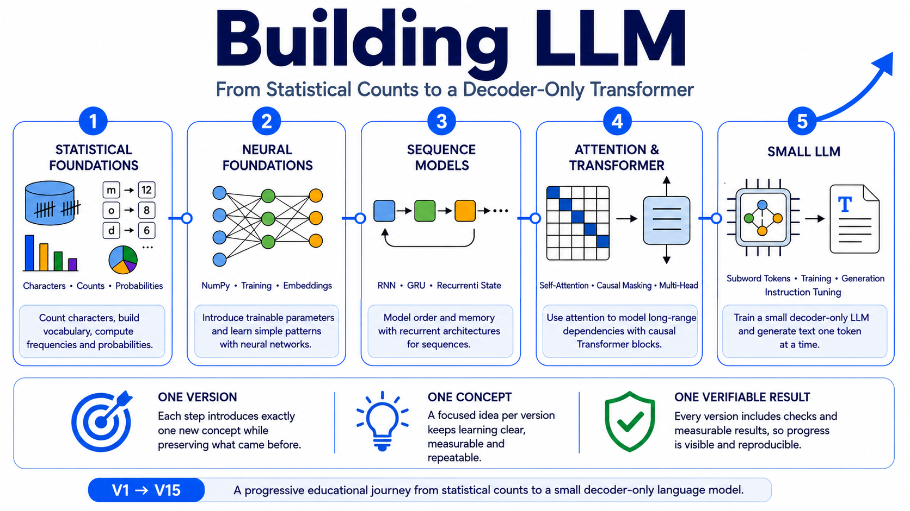

# Building LLM

A progressive educational project that shows how language models are built step by step, from a simple character-level statistical model to a small decoder-only Transformer with public data, subword tokenization, checkpointed training, held-out evaluation, controlled generation, instruction tuning and explicit multi-head causal self-attention.

The project begins with standard Python and introduces one new concept in each version. The goal is not to compete with industrial models, but to make tokenization, probability, training, neural networks, attention and autoregressive generation easier to understand.

  [](LICENSE) [](https://www.kaggle.com/code/lucalullo/building-llm)

[Kaggle notebook](https://www.kaggle.com/code/lucalullo/building-llm) · [GitHub repository](https://github.com/lucalullo/building-llm) · [Technical report](project-report-en.pdf)



## Overview

The complete project evolves through five main stages:

1. statistical foundations;
2. neural foundations;
3. sequence models;
4. attention and Transformer architecture;
5. a small decoder-only language model with public data, checkpointed training, evaluation, controlled generation, instruction tuning and multi-head causal self-attention.

Each stage introduces the concepts required by the next one while keeping the implementation understandable and verifiable.

## Current capabilities

Version 15 is the final planned stage of the original project roadmap. It preserves the complete Version 14 pipeline and introduces one isolated architectural change: **explicit multi-head causal self-attention**.

It continues directly from Version 14:

```text
Input representation:      (batch, 16, 8)
Projected Q / K / V:       (batch, 16, 16)
Split into heads:          (batch, 2, 16, 8)
Per-head attention:        (batch, 2, 16, 16)
Concatenated head output:  (batch, 16, 16)
Attention output:          (batch, 16, 8)
```

```text
Vocabulary size:          2048
Context length:             16
Embedding dimension:         8
Attention dimension:        16
Attention heads:             2
Head dimension:              8
Feed-forward dimension:     16
Transformer blocks:          2
Trainable variables:        23
Trainable parameters:   34,496
```

## Architecture

The important Version 15 distinction is internal to self-attention. Versions 11 through 14 use one 16-dimensional attention space per Transformer block. Version 15 reorganizes the same 16 projected dimensions into two independently normalized 8-dimensional causal heads, then concatenates them before the unchanged output projection. Because the trainable matrix shapes are preserved, the model remains exactly 34,496 parameters.

## Version guide

| Version | Focus | Notebook and resources |
|---:|---|---|
| 1 | Character Statistical Model | [`v1-character-model/`](v1-character-model/) |
| 2 | Neural Character Model with NumPy | [`v2-numpy-neural-model/`](v2-numpy-neural-model/) |
| 3 | Training Foundations | [`v3-training-foundations/`](v3-training-foundations/) |
| 4 | Introduction to TensorFlow | [`v4-tensorflow-introduction/`](v4-tensorflow-introduction/) |
| 5 | Embeddings and Context Window | [`v5-embeddings-context/`](v5-embeddings-context/) |
| 6 | Recurrent Language Model | [`v6-recurrent-language-model/`](v6-recurrent-language-model/) |
| 7 | GRU Language Model | [`v7-gru-language-model/`](v7-gru-language-model/) |
| 8 | Attention | [`v8-attention/`](v8-attention/) |
| 9 | Transformer Block | [`v9-transformer-block/`](v9-transformer-block/) |
| 10 | Decoder-Only Transformer | [`v10-decoder-only-transformer/`](v10-decoder-only-transformer/) |
| 11 | Subword Tokenization and Public Dataset | [`v11-subword-tokenization-and-public-dataset/`](v11-subword-tokenization-and-public-dataset/) |
| 12 | Training Pipeline and Checkpoints | [`v12-training-pipeline-and-checkpoints/`](v12-training-pipeline-and-checkpoints/) |
| 13 | Evaluation and Controlled Generation | [`v13-evaluation-and-controlled-generation/`](v13-evaluation-and-controlled-generation/) |
| 14 | Instruction Tuning | [`v14-instruction-tuning/`](v14-instruction-tuning/) |
| 15 | Explicit Multi-Head Causal Self-Attention | [`v15-multi-head-transformer-capstone/`](v15-multi-head-transformer-capstone/) |

### What each version introduces

<details>
<summary>Version 1 - Character Statistical Model</summary>

For every character in the corpus, the model counts which characters appeared immediately after it.

For example, the word `model` produces the following adjacent-character pairs:

</details>

<details>
<summary>Version 2 - Neural Character Model with NumPy</summary>

Version 2 preserves the character-level bigram structure introduced in Version 1, but replaces direct statistical counts with trainable parameters.

Each character is converted into an integer identifier and then represented as a one-hot vector.

</details>

<details>
<summary>Version 3 - Training Foundations</summary>

Version 3 preserves the same character-level neural model introduced in Version 2 and focuses on the foundations of a more structured training procedure.

The model still uses the same trainable weight matrix with shape:

</details>

<details>
<summary>Version 4 - Introduction to TensorFlow</summary>

Version 4 rebuilds the same neural character language model with TensorFlow without changing its architecture.

The model uses TensorFlow operations for its main calculations:

- `tf.one_hot` creates the input tensors;
- `tf.Variable` stores the trainable weight matrix;
- `tf.matmul` calculates the logits;
- `tf.nn.softmax` converts logits into probabilities;
- `tf.nn.sparse_softmax_cross_entropy_with_logits` calculates the loss;

</details>

<details>
<summary>Version 5 - Embeddings and Context Window</summary>

Version 5 changes the predictive model for the first time since the neural bigram was introduced.

Instead of representing one current character with a one-hot vector, the model now uses a fixed context containing four character identifiers:

</details>

<details>
<summary>Version 6 - Recurrent Language Model</summary>

Version 6 replaces the flattened context representation from Version 5 with a simple recurrent neural network.

The same four-character context windows and trainable embeddings are preserved, but the four embeddings are now processed sequentially from left to right.

</details>

<details>
<summary>Version 7 - GRU Language Model</summary>

Version 7 replaces the simple recurrent hidden-state update from Version 6 with a gated recurrent unit (GRU).

The same four-character context windows, trainable embeddings and 16-dimensional hidden state are preserved. The four embeddings are still processed sequentially from left to right, but the recurrent update now uses learned gates.

</details>

<details>
<summary>Version 8 - Attention</summary>

Version 8 replaces the gated recurrent processing from Version 7 with explicit scaled dot-product attention.

The same four-character context windows and trainable character embeddings are preserved, but recurrence is removed. Because the recurrent model previously represented sequence order implicitly, Version 8 adds trainable positional embeddings to the four context positions.

</details>

<details>
<summary>Version 9 - Transformer Block</summary>

Version 9 transforms the explicit attention mechanism from Version 8 into a complete single causal Transformer block.

The four-character context and trainable character and positional embeddings are preserved, but the training objective changes from one next-character target per context to four aligned sequential targets.

</details>

<details>
<summary>Version 10 - Decoder-Only Transformer</summary>

Version 10 turns the explicit single Transformer block from Version 9 into a small decoder-only Transformer composed of two reusable, independent Transformer blocks.

The same 440-character English corpus, 27-character vocabulary, four-character context, sequential next-character targets and character-level training objective are preserved.

- the Transformer operations are grouped into a reusable `TransformerBlock`;
- two independent block instances are stacked sequentially;
- the output of Transformer block 1 becomes the input of Transformer block 2;
- both blocks preserve the `(batch, 4, 8)` representation shape;
- each block has its own query, key, value, attention-output, LayerNorm and feed-forward parameters;

</details>

<details>
<summary>Version 11 - Subword Tokenization and Public Dataset</summary>

Version 11 keeps the two-block decoder-only Transformer from Version 10 and changes the representation of language entering the model.

The tiny hardcoded character corpus is replaced by **WikiText-103 Raw v1**, while character identifiers are replaced by BPE subword token identifiers.

- is trained only on the selected training subset;
- uses a maximum vocabulary size of 2048 tokens;
- includes a special `[UNK]` token;
- uses the `</w>` suffix to mark the end of a pre-tokenized word;
- never uses validation or test text to build the vocabulary.

</details>

<details>
<summary>Version 12 - Training Pipeline and Checkpoints</summary>

Version 12 preserves the complete Version 11 WikiText/BPE language-model experiment and adds explicit training-state management.

The model architecture, tokenizer, selected dataset rows, sequence caps, context length, parameter count, learning rate and total training budget remain unchanged.

</details>

<details>
<summary>Version 13 - Evaluation and Controlled Generation</summary>

Version 13 keeps the complete Version 12 training and checkpoint pipeline unchanged and adds a clearer held-out evaluation stage together with explicit decoding controls.

The validation-selected BEST model is restored before the WikiText test split is measured.

- start from the same held-out prompt;
- keep the same 16-token context;
- add exactly 40 new BPE tokens;
- use a local NumPy random generator for stochastic sampling;
- leave model weights unchanged.

</details>

<details>
<summary>Version 14 - Instruction Tuning</summary>

Version 14 preserves the complete Version 13 base model and adds a second learning stage: **supervised instruction tuning**.

A deterministic subset of **Databricks Dolly 15K** is used:

</details>

<details>
<summary>Version 15 - Explicit Multi-Head Causal Self-Attention</summary>

Version 15 preserves the complete Version 14 data, training, evaluation, checkpoint and instruction-tuning pipeline. The only new concept is explicit **multi-head causal self-attention**.

The existing 16-dimensional attention projection is reorganized into:

- attention rows sum to approximately 1;
- all future-position entries are zero;
- the attention tensor has the expected `(1, 2, 16, 16)` shape for the inspected example.

</details>

## Recorded evaluation

```text
Initial training loss:      7.626327
Initial validation loss:    7.625874
Best validation epoch:             18
Best validation loss:       5.075184
Final training loss:        4.982092
Final validation loss:      5.075184

Held-out cross-entropy:      5.098042
Held-out perplexity:       163.701
Top-1 accuracy:              0.0986
Top-5 accuracy:              0.2401
Uniform CE baseline:         7.624619
Uniform PPL baseline:     2048.0
```

These values are taken from the saved Version 15 execution; they are not claims about larger-scale language models.

## Getting started

### Requirements

- Python 3
- NumPy
- Pandas
- TensorFlow
- Hugging Face `tokenizers`
- Jupyter Notebook or JupyterLab

Version 1 uses only Python's standard library.

Versions 2 and 3 use NumPy for numerical representation and model training.

Versions 4 through 10 use NumPy and TensorFlow for numerical operations, model calculations, trainable parameter updates and automatic differentiation.

Versions 11 through 15 additionally use Pandas to read WikiText-103 Parquet files and the Hugging Face `tokenizers` library to train and apply the BPE tokenizer.

Versions 14 and 15 also require the external Databricks Dolly 15K instruction dataset file expected by the notebook.

No GPU is required.

Versions 11 through 15 require the documented WikiText-103 Raw v1 dataset files to be available at the dataset path expected by the notebook. The saved notebooks are configured for the attached Kaggle dataset input.

Versions 14 and 15 deliberately do not download or silently replace missing Dolly data. If the external instruction dataset is unavailable, the notebook stops explicitly.

Clone the repository:

```bash
git clone https://github.com/lucalullo/building-llm.git
cd building-llm
```

Start Jupyter Notebook:

```bash
jupyter notebook
```

To inspect the final planned version, open:

```text
v15-multi-head-transformer-capstone/building-llm.ipynb
```

Run the cells in order.

## Repository structure

Each version is kept in its own folder with the corresponding notebook and, where available, version-specific diagrams and reports.

## Documentation

- [Project report (English)](project-report-en.pdf)
- [Relazione del progetto (Italiano)](project-report-it.pdf)
- [Project infographic](infographic.png)

## Limitations

- only controlled subsets of WikiText-103 Raw v1 are used rather than full-dataset training;
- the language-model experiment uses 10,000 training rows, 1,000 validation rows and 1,000 test rows;
- the model uses at most 12,000 training sequences, 2,000 validation sequences and 2,000 test sequences;
- context length remains fixed at 16 BPE tokens;
- the tokenizer vocabulary contains only 2048 tokens;
- the whitespace-based BPE configuration is intentionally simple;
- whitespace pre-tokenization can produce spaces before punctuation after decoding;
- the model representation dimension remains only 8;
- total attention dimension remains 16;

## Project status

**Building LLM is complete according to the V1-V15 structure originally planned for the project.**

The repository now contains the full educational path from statistical character counts to a small decoder-only Transformer with public subword data, explicit checkpointed training, held-out evaluation, controlled generation, supervised instruction tuning and explicit multi-head causal self-attention.

## License

Distributed under the [MIT License](LICENSE).

## Author

Created by [Luca Lullo](https://github.com/lucalullo).
